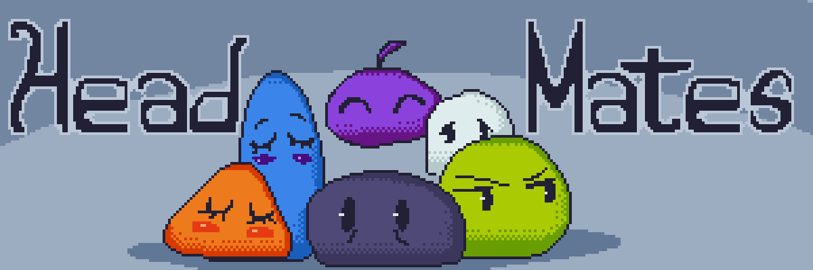

# HeadMates

**A home in Minecraft for every alter in your system.**

HeadMates is a Fabric and NeoForge mod for **people with DID, OSDD and other plural experiences**. Each alter in your system can play as themselves: their own name, color, pronouns and skin, and their own inventory, progress and settings. They all share the same Minecraft account and the same worlds.

## Why a mod like this matters

Most games assume that **one account is one person**. For a system, that's rarely true.

When a different alter sits down to play, they often find someone else's inventory and someone else's keybinds. A half-finished build nobody remembers starting, a name in chat that isn't theirs. In some systems, memories are not shared among all the *alters*, or switching is not very frequent; as a result, it is possible to lose track of where you were, what you were doing, or who left a particular item in a certain place. That can be confusing and frustrating. Sometimes it's quietly invalidating, as if the game is telling you to be one person.

Games are where a lot of us rest, create and spend time with friends. HeadMates tries to make Minecraft fit the people playing it, instead of asking anyone to hide part of themselves to fit the game:

- 🏠 **Everyone gets their own space.** Your inventory, your progress, your settings: nobody else's things mixed in with yours.
- 🗣️ **Everyone gets their own name.** In chat, on the tab list and above your head, with your pronouns one hover away.
- 📝 **Alters can talk to each other.** A shared board and "last time" notes help bridge the gaps between switches.
- 🛡️ **Younger alters can be looked after.** Adult alters can set gentle protections for them.

We use words like *alter*, *system*, *headmate* and *fronting* because they're common for me. Your system may use different words, and that's completely okay.

> HeadMates is a game mod, not a medical or therapeutic tool. It's meant to make play a little easier and kinder, alongside whatever support you already have.

## Features

### 👥 Your system
- Give your system a name and add every alter. **All alters are equal**: nobody is marked as special.
- Each alter has a profile with **name, pronouns, color, an optional passcode, skin, arm style and cape**.
- **Anyone can add a new alter.** Each alter edits their own profile, and each alter can only delete themselves.
- Deleting the whole system needs **every alter to confirm, one by one**.

### 🎮 Each alter is their own player
Pick who's playing when you open a world or join a server. Each alter has their own, separately:
- inventory and ender chest
- health, hunger, XP and effects
- position and dimension
- advancements and statistics
- **Minecraft options**: keybinds, video, sound, language, resource packs…

Switching alters is as simple as leaving and coming back in as someone else.

### 🎨 Looks
- A **custom skin per alter**. Pick a PNG, drag it onto the window, or copy the skin of any Minecraft account by username.
- Classic or slim arms; show your account's cape or none.
- Skins are **shared with other players who have the mod**: no external skin services needed.

### 💬 Names in chat
- Your alter's name and color replace the account name in chat, on the tab list, in death and advancement messages, and **above your head**.
- **Hover over a name** to see their pronouns and system.
- Edit your profile from the pause menu and the change shows for everyone **instantly**.

### ⭐ "Who's fronting?"
- Choose who's fronting from the **title screen** and go straight into any world or server, no selector needed.
- It's forgotten when the game closes, so the next alter never ends up in someone else's profile by accident.

### 🔒 Passcodes
- Alters can protect their profile with a passcode. It's needed to play as them, edit them or delete them.
- Passcodes are stored **hashed**, never in plain text.
- Passcodes are there to stop accidents between alters, not to keep out someone with access to your files.

### 📖 System diary *(J)*
- **Board**: notes for the whole system ("I left the tools in the chest by the door").
- **Last time**: who played, when, for how long, where they were (world or server, dimension, coordinates) and the note they left.
- When you enter a world, a small notice tells you who was there last and whether they left a note.

### ✉️ Exit notes
- When you save and quit, HeadMates offers to leave a note for whoever comes next. You can always skip it.

### 🛡️ Protection for younger alters
Many systems include younger alters. On public servers with strangers, that matters. **Adult alters** (with their passcode) can mark an alter as a minor and set:
- **How much chat they see**: everything, only trusted people, only server notices, or nothing at all.
- **Which servers they can join.** If they try another one, an adult can allow it once or add it to the list.
- **A contacts note**: who they can or should reach out to, written and signed by an adult. It's shown prominently when they start playing, and it's always one click away in the pause menu.

### 🌐 Multiplayer
| Server | Client | What happens |
|---|---|---|
| With HeadMates | With HeadMates | Everything works: per-alter data, names, colors, pronouns, skins |
| With HeadMates | Without it | Can't join: they're asked to install the mod |
| Without HeadMates | With HeadMates | Joins normally. A notice explains that **only you** see your alter |

- Fabric and NeoForge players can play together on either kind of server.
- **For admins:** the server log shows which account is playing as which alter, and `/alters` lists them. Commands, bans and whitelists keep using account names. How to handle impersonation is up to each server's staff.

### 📦 Export and import
- Save your whole system (profiles, skins, options, board and history) to a `.headmate.zip`, and bring it to another computer.
- Alters keep their identity, so servers and worlds recognize their data.
- Importing can **add only the new alters** or **replace everything**. Replacing needs every alter to confirm.

### 🌱 Worlds you already had
- Opening a world from before you installed HeadMates? One alter can **inherit the progress that was already there**.
- Only one, so items are never duplicated.

### ⌨️ Hotkeys
| Key | Action |
|---|---|
| K | Open your profile and the system |
| J | Open the system diary |

Both can be changed in Options → Controls → HeadMates.

## Privacy

- Everything about your system lives **on your own computer**: profiles, skins, notes and history.
- No accounts, no telemetry, no tracking.
- The only optional connection is copying a skin by username, which asks Mojang's public API.
- On a server with HeadMates, the server only receives what's needed to show your alter to others: name, color, pronouns, system name and skin. Skins are kept in memory and forgotten when you leave.

## Limitations

- To switch alters, you leave and rejoin the world or server.
- Protection for younger alters is a **soft** protection. It helps avoid scares and slip-ups, but it can't stop someone from removing the mod or editing files. It only works if adult alters have passcodes, and the mod warns you if any don't.
- Other mods that store player data in their own files aren't split per alter. Anything saved in the player data is.
- Config files of other mods are shared by all alters.
- Forgotten passcodes can't be recovered yet. Please keep them somewhere safe.

## Requirements

- Minecraft **1.21.1**
- **Fabric Loader** 0.16+ *or* **NeoForge** 21.1+
- Java 21
- No other dependencies. On Fabric, the few Fabric API modules it needs are bundled inside the jar.
- Install it on the **client**, and on the **server** if you want everyone's alters to be shared there.

## Frequently asked questions

**Do I need a diagnosis to use HeadMates?**  
No. It was created for people with DID and OSDD, but if you suspect that you might have a disorder, please seek help.

**What happens if I uninstall it?**  
Your worlds still open. The game uses the data of the last alter who played there. Everything else stays in the `headmate` folders, ready if you reinstall.

**Can other players see who's behind an alter?**  
Other players see the alter's name, pronouns and system name. Server admins can see which account is playing as which alter, so they can moderate.

**Can I use it on a server that doesn't have it?**  
Yes. You'll see your alter's name, color and skin on your own screen, but the server and other players see your normal account. Your inventory and progress are your account's.

**What languages does it support?**  
English and Spanish. Translations are very welcome.

## Feedback

If you're plural and something here feels wrong, missing or uncomfortable, we really want to hear it. This mod is for you, and it should feel like it.

Contact us at [**Discord**](https://discord.gg/YHqMTRYAMT), [**Twitter**](https://twitter.com/RuDaHee), or [**Github**](https://github.com/SteelCodeTeam/headmates) if you have any questions or feedback.

Made with care by **RuDaHee**. Free and open source under the **GPL-3.0** license.
